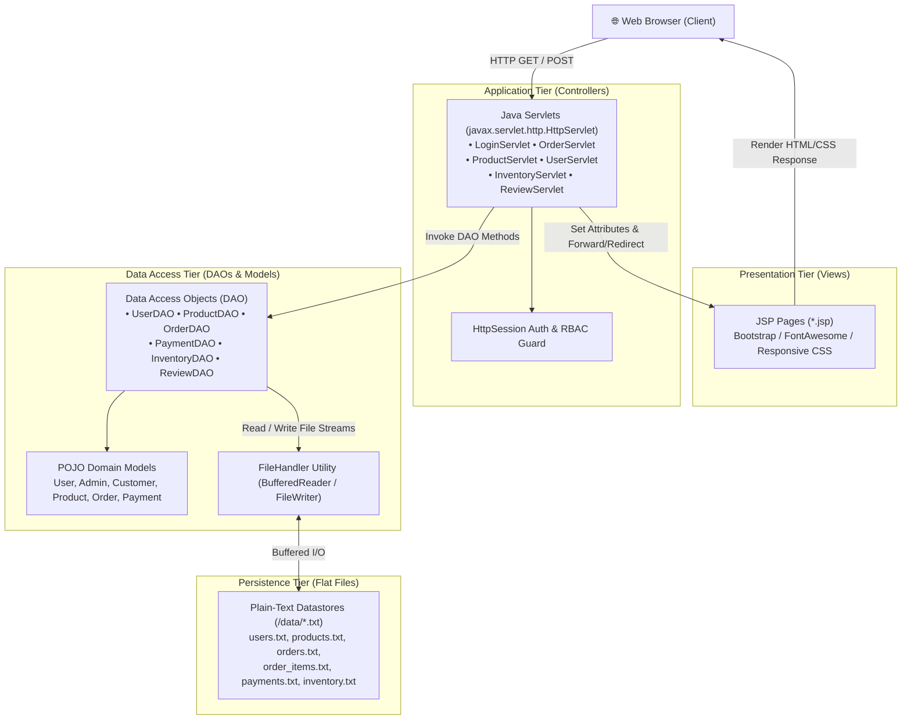

# 🛒 CeylonFresh — Online Grocery Ordering & Management System

[](https://www.oracle.com/java/)
[](https://tomcat.apache.org/)
[](https://tomcat.apache.org/)
[](https://maven.apache.org/)
[](https://en.wikipedia.org/wiki/Model%E2%80%93view%E2%80%93controller)
[](#-license)

> **CeylonFresh** is an enterprise-grade full-stack Java web application engineered using **Java Servlets**, **JavaServer Pages (JSP)**, and a custom **File-Based Persistence Engine** (Zero-Database Architecture). Designed to simulate a high-throughput grocery supply chain with robust **Role-Based Access Control (RBAC)** across Customers, Store Administrators, and Delivery Personnel.

---

## 📑 Table of Contents

- [🌟 Key Architectural Highlights](#-key-architectural-highlights)
- [👥 Role-Based Feature Modules](#-role-based-feature-modules)
  - [1. Customer Experience Portal](#1-customer-experience-portal)
  - [2. Administrator Command Center](#2-administrator-command-center)
  - [3. Delivery & Logistics Operations](#3-delivery--logistics-operations)
- [🏛️ System Architecture](#️-system-architecture)
- [🧩 Object-Oriented Design (OOP)](#-object-oriented-design-oop)
- [💾 Data Persistence Engine (Flat-File Storage)](#-data-persistence-engine-flat-file-storage)
- [📂 Clean Project Directory Structure](#-clean-project-directory-structure)
- [⚙️ Getting Started & Installation](#️-getting-started--installation)
  - [Prerequisites](#prerequisites)
  - [Local Deployment](#local-deployment)
  - [Default Test Credentials](#default-test-credentials)
- [🔮 Future Enhancements](#-future-enhancements)
- [👨‍💻 Author & Acknowledgments](#-author--acknowledgments)

---

## 🌟 Key Architectural Highlights

- **Zero External Database Dependency**: Built with an in-house flat-file persistence system utilizing structured CSV delimiters with file locking, buffering, and thread-safe read/write semantics.
- **Strict 3-Tier MVC Architecture**: Complete decoupling of presentation logic (`JSP`), business and routing controllers (`Java Servlets`), and data mapping layers (`DAO` + `POJO`).
- **Complete Order Lifecycle State Machine**: End-to-end status tracking from basket checkout to final delivery:
  $$\text{Confirmed} \longrightarrow \text{Prepared (Admin)} \longrightarrow \text{Picked Up (Delivery)} \longrightarrow \text{Delivered (Customer COD Reconciliation)}$$
- **Dynamic Role-Based Access Control (RBAC)**: Session-governed authorization protecting administrative actions, order dispatch, and user profiles.
- **Modern Responsive UI**: Built with accessible HTML5, responsive CSS grid/flexbox layouts, FontAwesome 6 icons, and toast notifications.

---

## 👥 Role-Based Feature Modules

### 1. Customer Experience Portal
* **Authentication & Profile**: Self-service registration, secure credential verification, and dedicated user profile management (`profile.jsp`).
* **Interactive Product Catalog**: Real-time product browsing, dynamic keyword search, category filtering, stock availability indicators, and product expiry dates.
* **Smart Shopping Cart**: Session-persistent cart allowing real-time quantity adjustments, price recalculations, and item deletions.
* **Secure Checkout**: Support for multiple payment methods (Credit/Debit Card & Cash on Delivery) with automatic order invoice generation.
* **Order & Payment Tracking**: Historic audit logs of previous orders (`orders.jsp`) and transaction status histories (`paymentHistory.jsp`).
* **Feedback & Review System**: Interactive 5-star rating and customer review portal (`reviews.jsp`).
* **Notification Feed**: Real-time alerts on dispatch changes, order confirmations, and promotional broadcasts.

### 2. Administrator Command Center
* **User Management**: Real-time listing, auditing, and deletion of registered user accounts.
* **Product Catalog CRUD**: Add, update, and remove products with image URLs, categorization, unit pricing, inventory stock, and expiry date monitoring.
* **Order Fulfillment Pipeline**: Audit incoming customer orders, review shipping addresses, and transition order status to `Prepared`.
* **Inventory Control & Restocking**: Track low-stock alerts (< 20 units) and initiate restock purchase requests linked to suppliers.
* **Financial Auditing**: View centralized payment records with status filtering and total revenue aggregations.
* **Notification Broadcast Engine**: Targeted notifications to individual users, specific roles (`Customer`, `Delivery`), or system-wide announcements (`All`).
* **Review Moderation & Analytics**: Review management and operational performance metrics.

### 3. Delivery & Logistics Operations
* **Dispatch Queue**: Real-time view of orders flagged as `Prepared` ready for field pickup.
* **Field Logistics Actions**: One-click status updates (`Picked Up`, `Delivered`, `Not Delivered`).
* **Automated Payment Reconciliation**: Marking a Cash-on-Delivery order as `Delivered` automatically reconciles and marks the payment as `Completed`.
* **Inventory Notification Feed**: Operational alerts regarding restock arrivals and route dispatches.

---

## 🏛️ System Architecture



---

## 🧩 Object-Oriented Design (OOP)

| OOP Principle | Implementation in CeylonFresh |
| :--- | :--- |
| **Encapsulation** | All entities (`User`, `Product`, `Order`, `Payment`, `Inventory`, `Review`) enforce private attributes exposed exclusively via typed getters, setters, and serialization methods. |
| **Inheritance** | Hierarchical model architecture where `Admin` and `Customer` extend the base `User` class to share core authentication properties while maintaining role autonomy. |
| **Polymorphism** | Overridden behaviors and interface methods across entity models (e.g., custom `toFileString()` implementations formatting domain records into persistent flat records). |
| **Abstraction** | Servlets interact exclusively with DAOs via abstract service signatures (`getAllProducts()`, `addOrder()`), cleanly decoupling file stream implementations from business workflows. |

---

## 💾 Data Persistence Engine (Flat-File Storage)

Data is persisted inside `{webapp_root}/data/` using standardized delimiter formats:

| File Name | Schema Definition |
| :--- | :--- |
| `users.txt` | `userId, name, email, password, role` |
| `admins.txt` | `adminId, name, email, password, role` |
| `products.txt` | `productId, name, category, price, stock, imageUrl, description, expiryDate` |
| `cart.txt` | `cartId, userId, productId, quantity` |
| `orders.txt` | `orderId, userId, name, total, paymentMethod, address, phone, status, deliveryId` |
| `order_items.txt` | `orderItemId, orderId, productId, quantity, price` |
| `payments.txt` | `paymentId, orderId, method, amount, status` |
| `inventory.txt` | `inventoryId, productId, productName, stock, supplier, status` |
| `reviews.txt` | `reviewId, productName, userName, rating, comment` |
| `notifications.txt` | `notificationId, recipient, title, message, timestamp, isRead` |

---

## 📂 Clean Project Directory Structure

```
Online_Grocery_Order_System/
├── pom.xml                               # Maven build configuration (Java 17, Servlet 4.0, War packaging)
├── .gitignore                            # Production-grade Git ignore policy
├── README.md                             # Comprehensive technical documentation
└── src/
    └── main/
        ├── java/
        │   └── com/grocery/
        │       ├── model/                # Domain entities & POJOs
        │       │   ├── Admin.java
        │       │   ├── Cart.java
        │       │   ├── Customer.java
        │       │   ├── Inventory.java
        │       │   ├── Notification.java
        │       │   ├── Order.java
        │       │   ├── Payment.java
        │       │   ├── Product.java
        │       │   ├── Review.java
        │       │   └── User.java
        │       ├── dao/                  # Data Access Objects (File I/O handlers)
        │       │   ├── InventoryDAO.java
        │       │   ├── NotificationDAO.java
        │       │   ├── OrderDAO.java
        │       │   ├── PaymentDAO.java
        │       │   ├── ProductDAO.java
        │       │   ├── ReviewDAO.java
        │       │   └── UserDAO.java
        │       ├── servlet/              # HTTP Controllers & Dispatchers
        │       │   ├── CartServlet.java
        │       │   ├── InventoryServlet.java
        │       │   ├── LoginServlet.java
        │       │   ├── LogoutServlet.java
        │       │   ├── NotificationServlet.java
        │       │   ├── OrderHistoryServlet.java
        │       │   ├── OrderServlet.java
        │       │   ├── PaymentHistoryServlet.java
        │       │   ├── PaymentServlet.java
        │       │   ├── ProductServlet.java
        │       │   ├── ReviewServlet.java
        │       │   └── UserServlet.java
        │       └── util/
        │           └── FileHandler.java  # Reusable buffered file stream utility
        └── webapp/
            ├── WEB-INF/
            │   └── web.xml               # Web deployment descriptor
            ├── css/
            │   ├── home.css              # Landing page styling
            │   └── style.css             # Unified application styles
            ├── data/                     # Seeded flat-file datastores
            │   ├── admins.txt
            │   ├── cart.txt
            │   ├── inventory.txt
            │   ├── notifications.txt
            │   ├── order_items.txt
            │   ├── orders.txt
            │   ├── payments.txt
            │   ├── products.txt
            │   ├── reviews.txt
            │   └── users.txt
            └── *.jsp                     # Presentation templates (Dashboards, CRUD Views, Storefront)
```

---

## ⚙️ Getting Started & Installation

### Prerequisites
- **Java Development Kit (JDK)**: Version 17 or higher
- **Servlet Container**: [Apache Tomcat 9.x](https://tomcat.apache.org/download-90.cgi) (Recommended) or 10.x
- **Build Tool**: [Apache Maven 3.8+](https://maven.apache.org/)
- **IDE**: IntelliJ IDEA (Ultimate or Community with SmartTomcat), Eclipse EE, or VS Code

### Local Deployment

1. **Clone the Repository**:
   ```bash
   git clone https://github.com/IT25102051/Project---Online-Grocery-Order-System.git
   cd Project---Online-Grocery-Order-System
   ```

2. **Build the WAR Package using Maven**:
   ```bash
   mvn clean package
   ```
   *This compiles the Java classes and generates `target/Online_Grocery_Order_System.war`.*

3. **Deploy to Apache Tomcat**:
   - **Method A (Standalone Tomcat)**:
     Copy `target/Online_Grocery_Order_System.war` into your Tomcat `webapps/` folder and execute `bin/catalina.bat run` (Windows) or `bin/catalina.sh run` (macOS/Linux).
   - **Method B (IntelliJ IDEA with SmartTomcat)**:
     1. Open the project in IntelliJ IDEA.
     2. Install the **SmartTomcat** plugin.
     3. Create a SmartTomcat Run Configuration:
        - **Tomcat Server**: Point to your Tomcat 9 directory.
        - **Deployment Directory**: Point to `src/main/webapp`.
        - **Context Path**: `/` or `/Online_Grocery_Order_System`.
     4. Click **Run / Debug**.

4. **Launch Application**:
   Open your browser and navigate to:
   ```
   http://localhost:8080/Online_Grocery_Order_System/
   ```
   *(Or `http://localhost:8080/` if deployed to root context)*.

### Default Test Credentials

| Role | Email | Password | Access Portal |
| :--- | :--- | :--- | :--- |
| **Admin** | `admin@gmail.com` | `admin123` | `/adminLogin.jsp` |
| **Delivery** | `delivery@gmail.com` | `delivery123` | `/login.jsp` |
| **Customer** | `customer@gmail.com` | `customer123` | `/login.jsp` |

---

## 🔮 Future Enhancements

- [ ] Migration from flat-file storage to an enterprise RDBMS (MySQL / PostgreSQL with JPA & Hibernate).
- [ ] Integration of live payment gateways (Stripe / PayPal sandbox APIs).
- [ ] Automated SMS / Email dispatch alerts using Twilio and JavaMail API.
- [ ] Containerized deployment using Docker and Docker Compose.
- [ ] Spring Boot & RESTful API microservice refactoring.

---

## 👨‍💻 Author & Acknowledgments

- **Developer**: Vinuka Weerathunga
- **Institution**: Sri Lanka Institute of Information Technology (SLIIT)
- **Module**: Object-Oriented Programming (OOP)
- **GitHub**: [@IT25102051](https://github.com/IT25102051)

---

## 📄 License

This repository is published for academic, portfolio, and educational evaluation purposes under the **MIT License**.
